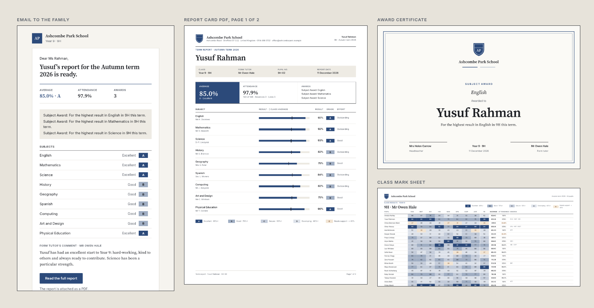
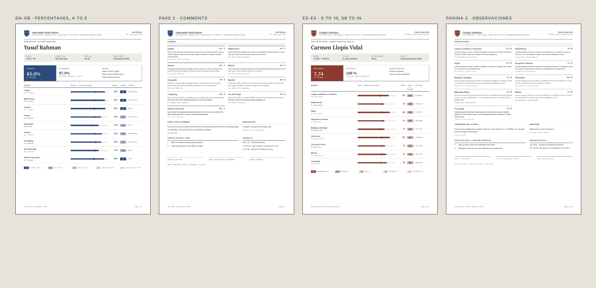
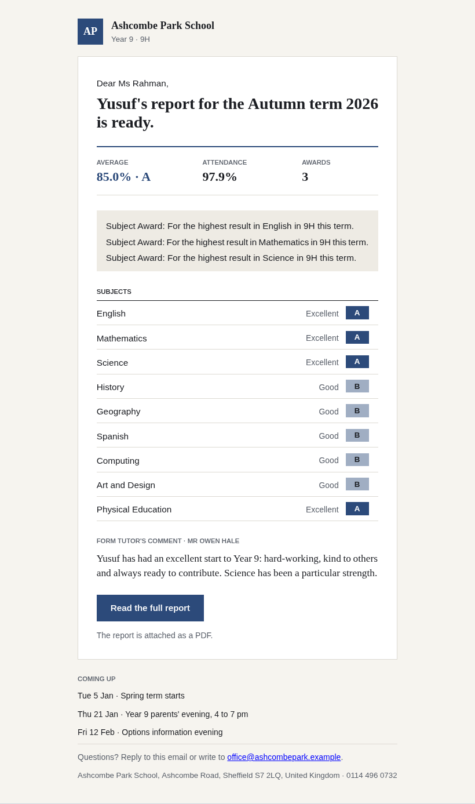
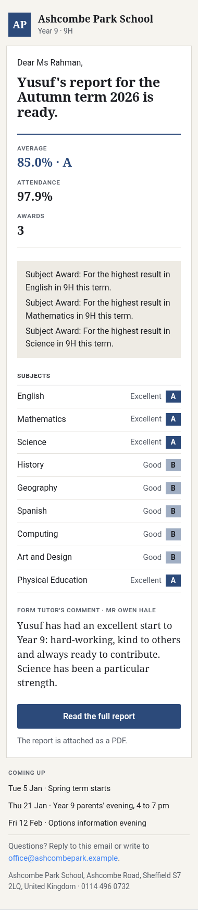
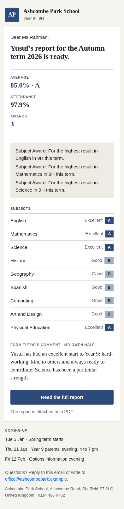
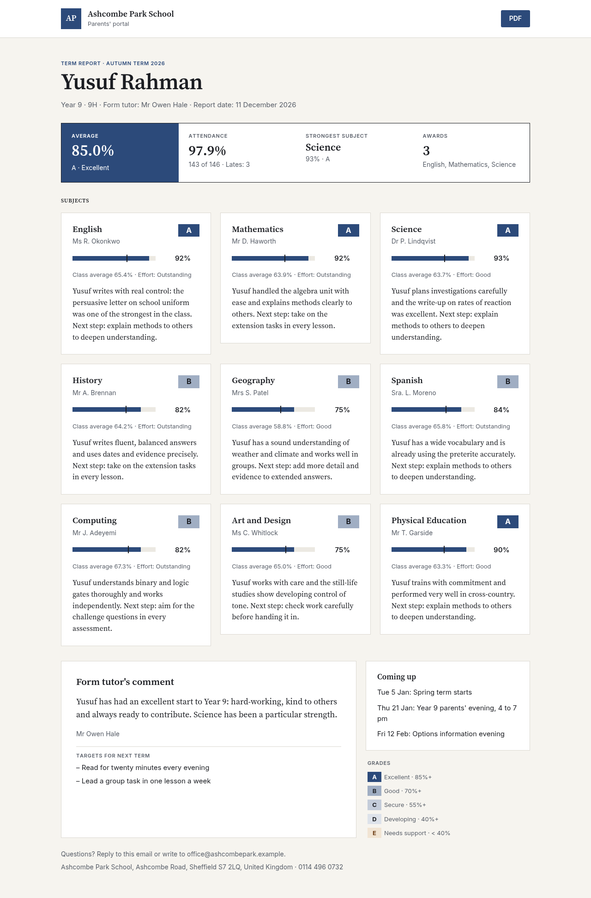
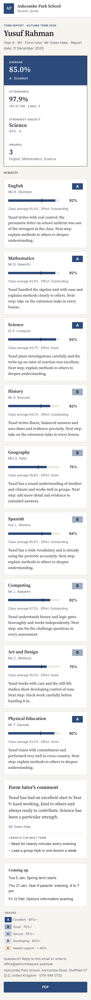
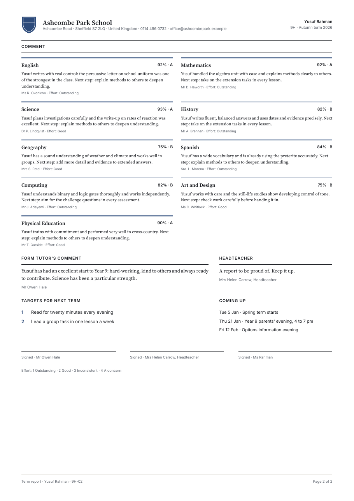

# Term Report

**One class file in. Every family's email, a web report, a two-page report card PDF, award certificates and the staff mark sheet out.**

A school reporting kit for [Hyper Elements](https://hyperelements.dev), built for the Hyper Elements Template Challenge (November 2026). It is for the people who send reports home at the end of a term: a school's data manager or office, a head of year, or a school information system that wants report output it doesn't have to build. Export the term's marks, attendance and comments from your MIS or a spreadsheet into one JSON file; Term Report makes everything a family and a staff room need, for the whole class at once, in the school's own grading scale and language.



**For judges, no install needed:** every output is committed in [`examples/`](examples). Open [`examples/ashcombe-park-9h/sample/`](examples/ashcombe-park-9h/sample) for one pupil's full set, [`examples/ashcombe-park-9h/class/`](examples/ashcombe-park-9h/class) for all 24 pupils, [`examples/ashcombe-park-9h/certificates/`](examples/ashcombe-park-9h/certificates) for the awards, and [`examples/checks.json`](examples/checks.json) for the gate's result.

## What it makes

From one class file (`data/*.json`), each output with a job only its format can do:

| Output | Root | Job | Sample |
| --- | --- | --- | --- |
| Email to the family + plain text | `Email` | Addressed to the pupil's named guardians: the average, attendance and awards above the fold, every subject with its grade, the tutor's comment, the dates ahead, a button to the full report. The PDF goes as an attachment. | [`email.html`](examples/ashcombe-park-9h/sample/email.html), [`email.txt`](examples/ashcombe-park-9h/sample/email.txt) |
| Web report | `Page` | The whole report on the school's portal, mostly read on phones: a card per subject with the result drawn against the class average, effort, the teacher's comment; tutor and head, targets, dates, grading key. | [`page.html`](examples/ashcombe-park-9h/sample/page.html) |
| Report card, A4, two pages | `Document` → `renderPdf()` | The copy a family files and a school keeps on record. Page 1: the term at a glance and every subject as a result bar against the class average. Page 2: every teacher's comment, tutor and head, targets, dates and signature lines. | [`report.pdf`](examples/ashcombe-park-9h/sample/report.pdf) |
| Award certificate, 1600×1131 | `Canvas` → `renderImage()` | One per award, worked out from the results by rule: top result in a subject, full attendance, most improved, best average. Printable on A4 landscape, or shared by a family. | [`certificates/`](examples/ashcombe-park-9h/certificates) |
| Class mark sheet, A4 landscape | `Document` → `renderPdf()` | For staff, not families: a row per pupil, a column per subject, each result tinted by its grade band, averages, attendance and awards. Where a head of year spots the pupil struggling in four subjects before reports go out. | [`class-overview.pdf`](examples/ashcombe-park-9h/class-overview.pdf) |
| The class batch | all of the above | Every pupil's email, page and report card, and every certificate, from the same file in one run (24 pupils, 14 certificates, about 7.5 seconds). | [`class/`](examples/ashcombe-park-9h/class) |

Awards are never typed in. The file gives rules (`subject-top` with a minimum score, `full-attendance`, `most-improved`, `top-overall`), and a tie is a shared award, never a coin toss.

### Any grading scale, any language

The scale, its grade bands, effort descriptors, locale and every printed word come from the file. Two samples, both fictional:

| File | School | Locale, scale | Shows |
| --- | --- | --- | --- |
| [`ashcombe-park-9h.json`](data/ashcombe-park-9h.json) | Ashcombe Park School, Sheffield. Year 9, form 9H, autumn term 2026 | en-GB, percentages, A to E | 24 pupils, 9 subjects, 146 sessions of attendance, 14 awards |
| [`colegio-altamira-1eso-b.json`](data/colegio-altamira-1eso-b.json) | Colegio Altamira, Valencia. 1.º ESO B, primer trimestre | es-ES, 0 to 10, SB / NT / BI / SU / IN | **Every label in Spanish** through the file's `labels`, decimal commas, Spanish dates |



Each school's accent colour comes from the file; the grade colours are worked out from it (the top band in the accent, lower bands as tints, the lowest in a warm amber that reads as "needs support" without shouting red).

## How Hyper Elements is used

| What | Where |
| --- | --- |
| **All four roots**, each with its own job: `Email` (the family), `Page` (the portal), `Document` (the report card, and the landscape mark sheet), `Canvas` (the certificate) | [`templates/`](templates) |
| **One theme**, `defineTheme()` with colour, font, size and line-height tokens, element defaults (heading scale in Source Serif, Button, Divider), a named `card` style and a `formats.document` override (white paper, 10.5px body). Each school's accent goes in through **`extendTheme()`** | [`src/theme.ts`](src/theme.ts) |
| **`defineElement()`** for typed, validated blocks: `termreport.GradeChip` (a grade on its band colour) and `termreport.Crest` (the school's letters, a logo that shows with images off) | [`src/parts.tsx`](src/parts.tsx) |
| **`Svg` with `Rect`, `Line`, `Path`**: the result bar with a class-average tick, the school shield, the certificate's rule. Only in the Page, Document and Canvas (an Email gets no Svg; it shows grade chips instead) | [`src/parts.tsx`](src/parts.tsx) |
| **`Layer`** to set the school's letters inside the drawn shield on the certificate | `LetteredShield` in [`src/parts.tsx`](src/parts.tsx) |
| **`Grid` with `columns`, `rowGap` and `stackOnMobile`**: the page's subject cards (three across, one on a phone), the report card's two-column comments, the grading key | [`templates/report-page.tsx`](templates/report-page.tsx), [`templates/report-card.tsx`](templates/report-card.tsx) |
| **`Table` / `TableRow header` / `TableRow footer` / `TableCell`** for the mark sheet, with band-tinted cells and class averages as the footer row | [`templates/class-overview.tsx`](templates/class-overview.tsx) |
| **Document parts**: `Document.Page` for the report card's two pages, `PageHeader`, `PageFooter`, `PageNumber` and `PageNumber total`, `orientation="landscape"` for the mark sheet | [`templates/report-card.tsx`](templates/report-card.tsx), [`templates/class-overview.tsx`](templates/class-overview.tsx) |
| **Phone styles and `hidden`** in the Email and Page only: the type steps down, panels stack, the page swaps its card grid for a single column with wider bars | [`templates/report-email.tsx`](templates/report-email.tsx), [`templates/report-page.tsx`](templates/report-page.tsx) |
| **`render()`** for the email's HTML and plain-text twin and the page; **`renderPdf()`** and **`renderImage()`** natively, fonts passed as bytes, no headless browser at render time | [`scripts/make.tsx`](scripts/make.tsx), [`src/fonts.ts`](src/fonts.ts) |
| **The gate**: the data checks, then **`validate()`** on every artefact for every pupil, with **`emailClients()`** and **`lint({ kind: "transactional" })`** on each email and `lint()` on each page. Errors **and warnings** fail it, which includes a report card page that overflows (`document/overflow`), so long comments are caught before a PDF is cut off. `make` renders nothing unless the whole class passes | [`scripts/lib.tsx`](scripts/lib.tsx), [`src/check.ts`](src/check.ts) |
| **`renderInEmailClients()`** previews of classic Outlook, Gmail (web and app) and Apple Mail (light, dark, iPhone), screenshotted | [`scripts/shots.tsx`](scripts/shots.tsx), [`examples/ashcombe-park-9h/clients/`](examples/ashcombe-park-9h/clients) |
| **Gallery-ready**: every template has `export const meta = { title, description, root }` and a default export that renders the sample with no props, the shape of the official gallery's templates, so `npx hyper-elements check templates/report-email.tsx` works on any of them | [`templates/`](templates) |

The current gate result is in [`examples/checks.json`](examples/checks.json): **0 errors, 0 warnings** across 124 artefacts (87 for Ashcombe Park, 37 for Colegio Altamira). The notes it counts are things a client draws slightly differently (Outlook squares corners and draws 500-weight text as normal) and lint's note on labels under 14px, each an accepted trade-off.

### In email clients

| Classic Outlook | Gmail app | Apple Mail, iPhone |
| --- | --- | --- |
|  |  |  |

What each client removed or changed is in [`clients/findings.json`](examples/ashcombe-park-9h/clients/findings.json). These are the library's local client models, not a send to real inboxes.

### More previews

| Web report, desktop | Web report, phone | Report card, page 2 |
| --- | --- | --- |
|  |  |  |

## Run it

Node.js 20 or later.

```bash
npm install
npm run check   # the gate: data checks + validate() + emailClients() + lint(), writes examples/checks.json
npm run make    # gate, then every output for every pupil in every file in data/ into examples/<file>/
npm test        # 21 tests: grade bands on two scales, averages, attendance, award rules and ties, data rules, the gate, page counts, certificate size
npm run shots   # optional: README screenshots and email-client previews (needs Chrome and poppler's pdftoppm)
```

Your own class: copy a file in `data/`, change it, and run `npm run make -- data/your-class.json`. Any template also renders on its own with the official CLI, for example `npx hyper-elements check templates/report-email.tsx`.

In an app, render from code:

```tsx
import { render } from "@hyper-elements/react";
import { renderPdf } from "@hyper-elements/react/pdf";
import ReportEmail from "./templates/report-email";
import ReportCard from "./templates/report-card";
import { loadFonts } from "./src/fonts";

const fonts = await loadFonts();
for (const pupil of classFile.pupils) {
  const { html, text } = await render(<ReportEmail file={classFile} pupil={pupil.id} />);
  const { pdf } = await renderPdf(<ReportCard file={classFile} pupil={pupil.id} />, { fonts });
  // send html + text to pupil.guardian.email with your email provider, with pdf attached
}
```

## The class file

```jsonc
{
  "school":   { "name", "monogram", "address": [], "website", "email", "phone", "accent", "head": { "name", "title" }, "portalUrl" },
  "settings": { "locale": "en-GB",
                "scale": { "max": 100, "decimals": 0, "suffix": "%", "bands": [{ "min": 85, "grade": "A", "label": "Excellent" }, ...] },
                "effort": ["Outstanding", "Good", "Inconsistent", "A concern"] },
  "labels":   { /* optional: any printed word, e.g. the Spanish sample's */ },
  "term":     { "name", "start", "end", "reportDate", "sessions": 146, "nextTerm", "dates": [{ "date", "label" }] },
  "class":    { "name": "9H", "year": "Year 9", "tutor": "Mr Owen Hale" },
  "subjects": [{ "code": "ENG", "name": "English", "teacher": "Ms R. Okonkwo" }],
  "awards":   [{ "code": "TOP", "rule": "subject-top", "title": "Subject Award", "description": "For the highest result in {subject} in {class} this term.", "minScore": 88 }],
  "pupils":   [{ "id", "name", "firstName", "guardian": { "name", "email" }, "attendance": { "present", "absent", "late" },
                 "previousAverage": 71.2, "results": { "ENG": { "score": 92, "effort": 1, "comment": "..." } },
                 "tutorComment", "headComment", "targets": [] }]
}
```

Types: [`src/types.ts`](src/types.ts). The data checks ([`src/check.ts`](src/check.ts)) refuse, with the path to fix: a score outside the scale, grade bands out of order or not reaching 0, attendance that doesn't add up to the term's sessions, a pupil missing a subject, an unknown subject code, an empty comment, a bad guardian email, an invalid locale or colour.

## Layout of the repo

```
data/                 two sample class files (fictional schools, pupils and staff)
src/types.ts          the class file's shape and every label
src/report.ts         the class worked out: bands, averages, attendance, award rules
src/check.ts          data checks, run before validate()
src/theme.ts          defineTheme() + extendTheme() per school, band colours
src/parts.tsx         defineElement() blocks, the shield, the result bar, shared parts
src/context.ts        what every template reads; the default sample
templates/            the five templates (Email, Page, Document x2, Canvas)
scripts/              check, make, shots
examples/             every rendered output, committed
tests/                vitest
assets/fonts/         Inter and Source Serif Pro (SIL OFL 1.1, licences included)
```

## Design

A school's printed report, not a dashboard: warm paper, ink, hairline rules, Source Serif for names, headings and the teachers' words, Inter for labels and figures. One accent per school, from its file, with the grade bands as tints of it. Results are bars against the class average, so a family sees "above the class" at a glance without a league table. No gradients, no emoji, no stock images.

## Limits

- Hyper Elements Documents do not flow content across pages, so the report card has two fixed pages, with comments sized for about 40 words each. The gate catches a page that would overflow (`document/overflow` is a warning, and warnings fail it), so longer comments are refused before rendering rather than cut off.
- Phone styles cannot change a table cell's width, so the page uses `Grid` cards that stack on phones rather than a table.
- Email clients get the font stacks only (web fonts are unreliable in email); the PDF and PNG embed Inter and Source Serif Pro.
- Term Report presents results; it does not calculate them from assessments. Scores are what your MIS or markbook exports.

## Licence

MIT, see [LICENSE](LICENSE). Fonts: Inter and Source Serif Pro under the SIL Open Font License 1.1 ([`assets/fonts/`](assets/fonts)). All schools, pupils, staff and results in `data/` are fictional.

## Author

Chris Gold, X: [@ChrisGold__](https://x.com/ChrisGold__), GitHub: [@AshThunder](https://github.com/AshThunder)
